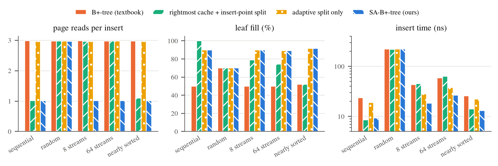
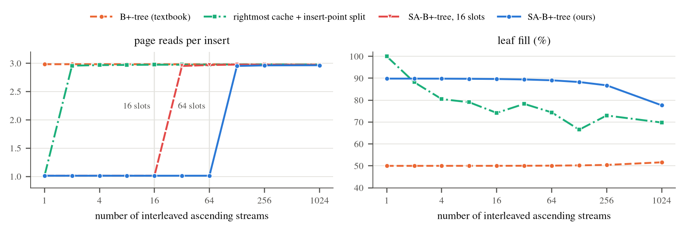
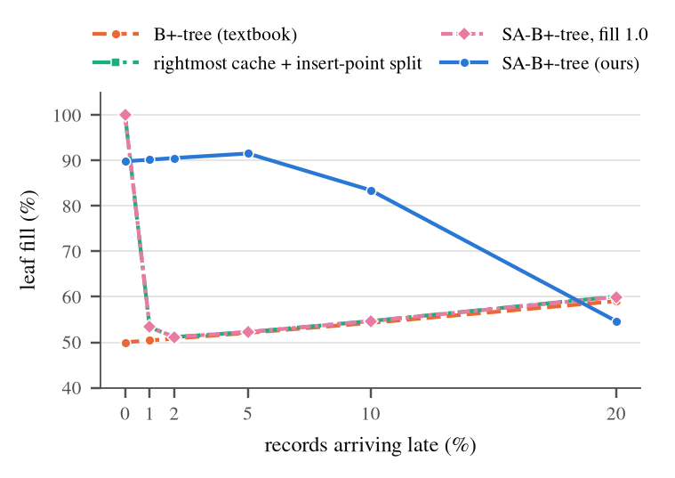

# Stream-Aware B+-Tree

A B+-tree index in C++17 that makes ascending inserts cheaper and keeps the
resulting pages full. "Ascending" covers auto-increment keys, timestamps, and
composite keys such as `(device_id, timestamp)` written by many devices at
once. Random inserts don't get slower.

It is a small, measured improvement on two tricks production databases already
use:

| existing technique | where | what it does | where it falls short |
|---|---|---|---|
| rightmost-leaf fastpath | PostgreSQL nbtree (since v11) | caches the rightmost leaf, so appends skip the root-to-leaf descent | only helps when *one* stream appends at the far right end of the index |
| insert-point split | InnoDB | when the last two inserts were adjacent, splits the page at the insert point instead of in the middle | with interleaved streams it strands the neighbour's keys and under-fills pages (cf. MySQL bug #67718); packing pages 100% full falls apart as soon as a few records arrive late |

The **SA-B+-tree** (stream-aware B+-tree) changes three things:

1. **Run-gated adaptive split.** Every node remembers where its last insert
   landed and how many inserts in a row went immediately to the right of the
   previous one. Once a node has seen `run_threshold = 3` such inserts, a
   split cuts **right after the new key**, so whatever followed the run
   (another stream's keys) moves out. On a pure append it keeps
   `seq_fill = 90%` of a page on the left, leaving room for late records,
   the same headroom as PostgreSQL's default B-tree fillfactor. The same
   policy applies to inner nodes.
2. **Multi-slot leaf hint cache.** A 64-entry cache of recently written leaves,
   each stored with its exact fence keys `[low, high)`. An insert whose key
   falls inside a cached range goes straight to that leaf: one page read
   instead of one per tree level. Fences are updated on every split, so a hint
   is never stale. It generalises the PostgreSQL fastpath from "the
   rightmost leaf" to "any 64 leaves", so it covers many concurrent streams.
3. **Hit-rate gating.** Every 64 probes the cache checks its own hit rate.
   Below 50% (random keys, or more streams than slots) it switches to
   sampling one insert in 64, and it switches back on once samples hit
   again. Random-key workloads therefore pay almost nothing for it.

## Results

2,000,000 inserts of 64-bit keys, 256-entry nodes (≈ 4 KiB pages),
in memory, single thread, Intel Core Ultra 9 285H, GCC 16 `-O3`. Times are the
best of 7 interleaved runs (see [Methodology](#methodology)); page counts are
exact and deterministic.

| workload | variant | ns / insert | page reads / insert | leaf fill | index size |
|---|---|---:|---:|---:|---:|
| sequential | textbook B+-tree | 23.6 | 2.98 | 50.0% | 61.5 MiB |
| | rightmost cache + insert-point split | 8.6 | 1.01 | 100.0% | 30.6 MiB |
| | **SA-B+-tree** | **9.4** | **1.01** | **89.8%** | **34.1 MiB** |
| random | textbook B+-tree | 222.5 | 2.98 | 70.2% | 43.8 MiB |
| | rightmost cache + insert-point split | 219.8 | 2.98 | 70.0% | 43.9 MiB |
| | **SA-B+-tree** | **223.6** | **2.97** | **70.2%** | **43.8 MiB** |
| 8 interleaved streams | textbook B+-tree | 43.4 | 2.98 | 50.0% | 61.5 MiB |
| | rightmost cache + insert-point split | 45.0 | 2.97 | 79.0% | 38.8 MiB |
| | **SA-B+-tree** | **18.4** | **1.01** | **89.8%** | **34.2 MiB** |
| 64 interleaved streams | textbook B+-tree | 59.2 | 2.98 | 50.1% | 61.2 MiB |
| | rightmost cache + insert-point split | 63.9 | 2.98 | 74.4% | 41.3 MiB |
| | **SA-B+-tree** | **26.8** | **1.01** | **89.1%** | **34.5 MiB** |
| nearly sorted (5% late) | textbook B+-tree | 26.0 | 2.98 | 52.1% | 59.1 MiB |
| | rightmost cache + insert-point split | 14.1 | 1.10 | 52.3% | 58.8 MiB |
| | **SA-B+-tree** | **13.1** | **1.02** | **91.5%** | **33.5 MiB** |

Compared with the textbook tree, the SA-B+-tree:

- inserts 2.0–2.5× faster on every workload with key locality;
- needs 1.01–1.02 page reads per insert instead of ~3;
- builds an index 43–45% smaller;
- reads about a third fewer pages per 1,000-row range scan (7.3–7.4 vs
  10.5–10.8).

On random keys it is within 1% of the textbook tree: a dedicated A/B run over
21 interleaved repetitions measured 224.5 vs 222.4 ns. The existing
techniques combined match it on a single clean append stream, where 100%
packing even beats our 90%. They lose most of their benefit once there are
several streams or a few late records.



**Many streams.** The hint cache covers as many streams as it has slots, and
the adaptive split keeps pages ~90% full up to 64 streams (78% at 1,024).
Over the same range the insert-point heuristic falls to 67–88% (74% at 64
streams). Even once the cache has switched itself off (128+ streams), the
split alone keeps the SA-B+-tree about 1.5× faster than the textbook tree.



**Late records.** Packing pages 100% full is the right call only when *no*
record ever arrives late: with 1% stragglers, fill collapses to 53%. A 90%
limit holds ~90% up to 5% late records and 84% at 10%. At 20% late it is
worse than the textbook tree (55% vs 59%); see [Limitations](#limitations).



Full numbers, including the ablations (`rightmost`, `insert-point`,
`multi-hint`, `adaptive-split`, `sa-btree-f100`, `sa-btree-16slots`), are in
[`results/`](results/).

## Build, test, benchmark

Requirements: a C++17 compiler and CMake ≥ 3.16. The plots need Python 3 with
matplotlib (or [`uv`](https://docs.astral.sh/uv/), which fetches it).

```sh
cmake -S . -B build -DCMAKE_BUILD_TYPE=Release
cmake --build build -j
(cd build && ctest)                  # differential tests against std::map

./build/bench --quick --out /tmp     # 200k keys, ~2 s
CPU=2 scripts/run_benchmarks.sh      # full run: tests + 2M-key benchmarks into results/ (~2.5 min)
uv run scripts/plot_results.py       # redraw results/figures/
```

`CPU=<id>` pins the benchmark to one core with `taskset`. On hybrid Intel
CPUs, pick a performance core.

## Paper

[`paper/main.pdf`](paper/main.pdf) is a 6-page IEEE-style write-up. It covers
the design, a small cost model that predicts the measured page reads and fill,
the full evaluation and related work. Rebuild it with
`scripts/build_paper.sh`, which needs [tectonic](https://tectonic-typesetting.github.io/)
or latexmk; run `scripts/plot_results.py` first if the results changed.

## Using the tree

The library is header-only (`include/sabtree/`).

```cpp
#include "sabtree/bplus_tree.h"

sabtree::Options opts;
opts.split = sabtree::SplitPolicy::Adaptive;   // run-gated split, seq_fill = 0.9
opts.hints = sabtree::HintPolicy::Multi;       // 64-slot leaf hint cache

sabtree::BPlusTree tree(opts);
tree.insert(42, 7);                     // returns false if the key existed (value overwritten)
auto v = tree.find(42);                 // std::optional<Value>
tree.scan(10, 100, [](sabtree::Key k, sabtree::Value v) { /* keys in [10, 100] */ });
tree.erase(42);

auto io = tree.stats();                 // page reads/writes, splits, hint hits
auto shape = tree.shape();              // height, leaf/inner counts and fill
assert(tree.check().empty());           // structural invariants
```

`Options` also selects the baselines used in the evaluation:
`SplitPolicy::Middle` (textbook), `SplitPolicy::InsertPoint` (InnoDB-style),
and `HintPolicy::Rightmost` (PostgreSQL-style).

## Repository layout

```
include/sabtree/
  options.h        Options, SplitPolicy, HintPolicy, Stats, Shape
  bplus_tree.h     the tree: insert / find / scan / erase, split policies,
                   hint cache, invariant checker
  workloads.h      deterministic key-order generators (SplitMix64)
tests/             differential tests vs std::map for 10 configurations
bench/bench.cpp    benchmark driver (variants x workloads, two sweeps, A/B)
scripts/           run_benchmarks.sh, plot_results.py
results/           CSV results, ENV.txt (machine), figures/
paper/             LaTeX source, figures and PDF of the write-up
```

## Methodology

- **Logical I/O.** Nodes live in a page table and every node an operation
  visits counts as one page read. This is the classic cost model for
  disk-oriented indexes, and it is exact and deterministic.
- **Workloads.** Five key orders: `sequential` (0, 1, 2, …), `random` (a
  permutation), `streams-K` (K ascending sequences in disjoint key ranges,
  interleaved at random), and `nearly-sorted` (ascending, but a fraction of
  records is delayed by up to 1,000 positions). Each is generated with a fixed
  seed by a hand-written SplitMix64 / Fisher–Yates, so it is identical on
  every platform.
- **Timing.** Each configuration is built once untimed (warm-up), then 7
  timed times. Repetitions are interleaved across variants, and the fastest
  is reported, because on a laptop background load and clock changes only
  ever add time. Within a stable phase, repeated runs agree to within a few
  percent; across phases the absolute numbers can move ±10%, but the
  comparisons inside a table row block come from the same phase.
- **Correctness.** `tests/` drives every configuration (capacities 3 to 256)
  with the same operation streams as a `std::map`: inserts, overwrites,
  erases, lookups and range scans. After every batch it checks the full set
  of structural invariants: key order, fence keys, uniform leaf depth, the
  leaf chain, and that every cached hint still matches its leaf. The suite
  also passes under AddressSanitizer and UBSan.

## Limitations

- **In-memory, single-threaded.** No latching, buffer pool or WAL. In a real
  engine a skipped descent also saves latch traffic and buffer-pool lookups,
  so the in-memory timings here probably understate the benefit, but that is
  not measured.
- **Nodes are never merged** (erase is lazy, as in PostgreSQL before VACUUM).
  This keeps fence keys immutable outside splits, which the hint cache relies
  on.
- **Only ascending runs** are detected. Descending inserts fall back to
  middle splits.
- **Heavy disorder.** At about 20% late records the 90% limit stops helping,
  and fill drops below the textbook tree's (55% vs 59%). A simple fix would be
  to stop applying the limit once a node sees many out-of-order inserts.
- **Inner nodes with many streams.** Separators of different streams
  interleave inside inner nodes, so runs there are short and inner fill can
  be lower than the textbook tree's (56% vs 83% at 64 streams). Inner nodes
  are under 1% of the pages, so the effect on index size is negligible.

## References

- R. Bayer, E. McCreight. *Organization and maintenance of large ordered indexes.* Acta Informatica 1(3), 1972.
- D. Comer. *The ubiquitous B-tree.* ACM Computing Surveys 11(2), 1979.
- A. C. Yao. *On random 2–3 trees.* Acta Informatica 9(2), 1978. (the ln 2 ≈ 69% fill of random inserts)
- P. L. Lehman, S. B. Yao. *Efficient locking for concurrent operations on B-trees.* ACM TODS 6(4), 1981. (high keys / fences)
- G. Graefe. *Modern B-tree techniques.* Foundations and Trends in Databases 3(4), 2011.
- PostgreSQL commit 2b272734 (2018), *Optimize btree insertions for common case of increasing values*: the nbtree rightmost-leaf fastpath.
- MySQL bug #67718, *InnoDB drastically under-fills pages in certain conditions*.

## License

MIT. See [LICENSE](LICENSE).
